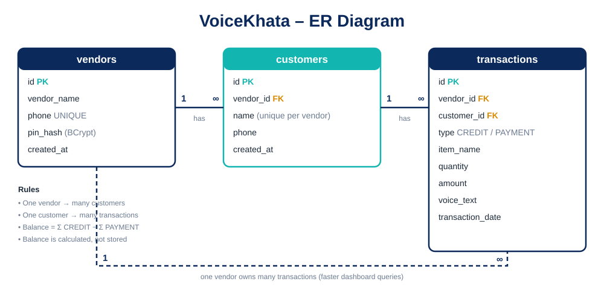

# VoiceKhata – Voice-Based Digital Credit Ledger

VoiceKhata replaces the handwritten *udhaar* notebook of small street vendors. The vendor speaks in **English, Hindi or Telugu**, the app converts the speech to text, extracts the transaction details with rule-based logic, asks the vendor to confirm, and keeps customer-wise pending balances in a MySQL database.

> Example: saying *"Ramu took 2 tea, 20 rupees"* creates **Customer: Ramu, Item: Tea, Quantity: 2, Amount: ₹20, Type: CREDIT**.

## Features

- Vendor registration and login with phone number and 4-digit PIN (PIN stored hashed with BCrypt)
- Dashboard: pending dues, total customers, this month's transactions, recent transactions
- Voice entry in English (en-IN), Hindi (hi-IN) and Telugu (te-IN) using the Web Speech API
- Rule-based parser (no external AI APIs): customer, item, quantity, amount, CREDIT or PAYMENT
- Confirmation card where every detail can be edited before saving, plus manual entry
- Customer-wise balances (balance = total credit − total payments)
- Add customers, edit phone numbers, search
- WhatsApp payment reminders using a `wa.me` link with a prefilled message
- Transaction history with filters (All, Credit, Payment, Pending, Paid), edit and delete
- Landing page in three languages

## Tech Stack

| Layer | Technology |
|---|---|
| Frontend | HTML5, CSS3, JavaScript, Bootstrap 5, Web Speech API |
| Backend | Java 17, Spring Boot 3, Spring Web, Spring Data JPA, Spring Validation |
| Security | BCrypt PIN hashing, bearer-token sessions |
| Database | MySQL 8 |

## Architecture





```
Browser (HTML + CSS + JS + Bootstrap, Web Speech API)
        |  HTTP + JSON (REST)   Authorization: Bearer <token>
        v
Spring Boot backend (port 8080)
   Controller -> Service -> Repository (JPA)
        |  JDBC
        v
MySQL database: vendors, customers, transactions
```

Speech-to-text runs in the browser. The parsing rules run in the frontend (`voice.js`). The backend validates, stores and calculates.

## Project Structure

```
VoiceKhata/
├── database/schema.sql
├── backend/                     (Spring Boot project)
│   └── src/main/java/com/voicekhata/backend/
│       ├── config/              CorsConfig, AppConfig
│       ├── controller/          Health, Auth, Customer, Transaction
│       ├── service/             AuthService, CustomerService, TransactionService, TokenStore
│       ├── repository/          Vendor, Customer, Transaction repositories
│       ├── entity/              Vendor, Customer, Transaction
│       ├── dto/                 request and response records
│       └── exception/           ApiException, GlobalExceptionHandler
└── frontend/
    ├── index.html, login.html, register.html
    ├── dashboard/dashboard.html
    ├── customers/customers.html
    ├── transactions/transactions.html
    ├── css/                     style.css, dashboard.css, landing.css, responsive.css
    └── js/                      auth.js, data.js, dashboard.js, voice.js,
                                 customers.js, transactions.js
```

## Database

Three tables: **vendors** (1) → (many) **customers** (1) → (many) **transactions**. The balance is never stored; it is calculated from the transactions, so it cannot go out of sync. See `database/schema.sql`.

## REST API

| Method | Endpoint | Purpose |
|---|---|---|
| GET | `/api/health` | Check that the backend is running |
| POST | `/api/auth/register` | Create a vendor account |
| POST | `/api/auth/login` | Login, returns a token |
| POST | `/api/auth/logout` | End the session |
| GET, POST | `/api/customers` | List (with `?search=`) or add a customer |
| PUT, DELETE | `/api/customers/{id}` | Edit phone or delete a customer |
| GET, POST | `/api/transactions` | List or save a transaction |
| PUT, DELETE | `/api/transactions/{id}` | Edit or delete a transaction |
| GET | `/api/dashboard` | Pending dues, counts, monthly totals, recent items |

All endpoints except health, register and login need the header `Authorization: Bearer <token>`.

## How to Run

**Requirements:** JDK 17, MySQL 8, Eclipse (or any IDE), VS Code with the Live Server extension, Google Chrome.

1. **Database:** open MySQL Workbench and run `database/schema.sql`.
2. **Backend:** open `backend/src/main/resources/application.properties` and set your MySQL password in `spring.datasource.password`. Run `BackendApplication` (Run As → Java Application). Check `http://localhost:8080/api/health`.
3. **Frontend:** open the project in VS Code, right-click `frontend/index.html` → **Open with Live Server**.
4. Register a vendor, log in, tap the mic and speak.

Start in this order every time: MySQL, then the backend, then Live Server. Logins are kept in memory, so restarting the backend means logging in again.

## Voice Examples

| Language | Sentence | Result |
|---|---|---|
| English | Ramu took 2 tea, 20 rupees | Ramu, Tea, 2, ₹20, CREDIT |
| English | Ramu paid 20 rupees | Ramu, ₹20, PAYMENT |
| Hindi | Ramu ne do chai liya bees rupaye | Ramu, Tea, 2, ₹20, CREDIT |
| Telugu | రాము 20 రూపాయలు ఇచ్చాడు | Ramu, ₹20, PAYMENT |

## Screenshots

Add your screenshots to `docs/screenshots/` and link them here:

```
### Landing Page


### Dashboard


### Voice Entry


### Customers


### Transactions

```

## Limitations and Future Work

- Voice recognition needs Google Chrome or Edge and an internet connection.
- Login tokens are kept in memory (JWT would be the production choice).
- One item per transaction; multi-item bills are a future improvement.
- Possible next steps: customer detail page, payment due dates, export to PDF or Excel, Hindi and Telugu translations for all pages.

## Author

Jasmin Shaik
Code Begun Institute
# VoiceKhata
Voice-based expense tracking and management application.
