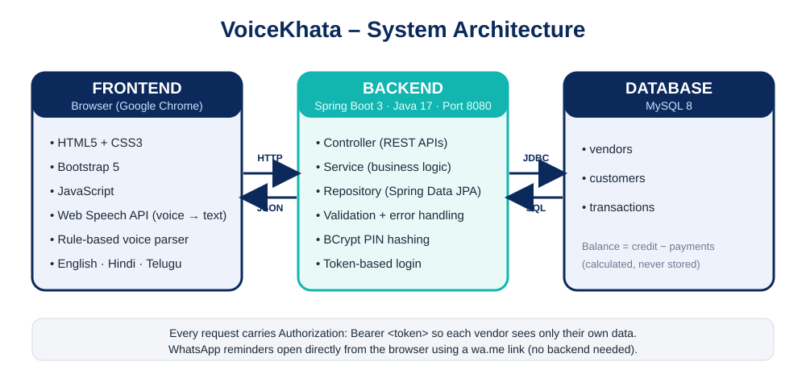
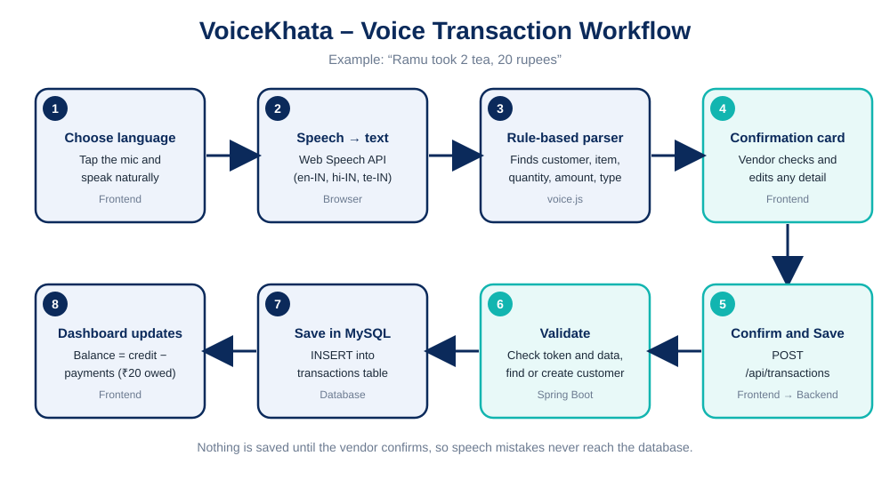

# VoiceKhata – Voice-Based Digital Credit Ledger

VoiceKhata is a voice-based digital credit ledger designed for small shopkeepers and street vendors to manage customer credit (udhaar), payments, and outstanding balances without relying on handwritten notebooks.

Vendors can record transactions using voice input in English, Hindi, or Telugu. The application converts speech into text, extracts transaction details using rule-based logic, allows the vendor to review and edit the details before saving, and stores the transactions in a MySQL database.

VoiceKhata also provides a Customer Portal where customers can view their shop dues and transaction information.

> Example: Saying "Ramu took 2 tea, 20 rupees" creates a transaction with Customer: Ramu, Item: Tea, Quantity: 2, Amount: ₹20, Type: CREDIT.

---

## Problem Statement

Small shopkeepers commonly maintain customer credit and payment records in handwritten notebooks. Managing these records manually can make it difficult to track outstanding balances, search transaction history, remember customer payments, and maintain accurate records.

VoiceKhata provides a simple digital solution to record credit and payment transactions, manage customers, calculate outstanding balances, and allow customers to view their dues.

---

## Features

### Vendor / Owner Features

- Vendor registration and login using phone number and 4-digit PIN
- Secure PIN hashing using BCrypt
- Dashboard showing pending dues, total customers, monthly transactions, and recent transactions
- Voice-based transaction entry in English, Hindi, and Telugu
- Speech-to-text using the Web Speech API
- Rule-based voice parser to extract customer, item, quantity, amount, and transaction type
- Transaction confirmation card with editable details before saving
- Manual transaction entry
- Credit (udhaar) and payment transaction management
- Customer management with add, edit, search, and phone number updates
- Support for customers with duplicate names
- Customer selection to associate transactions with the correct customer
- Customer-wise outstanding balance calculation
- Transaction history with filters for All, Credit, Payment, Pending, and Paid
- Edit and delete transactions
- WhatsApp payment reminders with prefilled messages
- Multilingual landing page

### Customer Features

- Customer Portal
- View outstanding dues
- View customer-specific transaction information
- Review credit records
- Review payment records

---

## User Workflows

### Vendor / Owner Workflow

1. Open VoiceKhata.
2. Register or log in as a vendor.
3. View the dashboard.
4. Add or manage customers.
5. Record a credit or payment transaction using voice or manual entry.
6. Review the extracted transaction details.
7. Edit details if required.
8. Confirm and save the transaction.
9. View updated customer balances and transaction history.

### Customer Workflow

1. Open the Customer Portal.
2. Access customer dues information.
3. View outstanding balance.
4. Check transaction history.
5. Review credit and payment records.

---

## Tech Stack

| Layer | Technology |
|---|---|
| Frontend | HTML5, CSS3, JavaScript, Bootstrap 5 |
| Voice Recognition | Web Speech API |
| Backend | Java 17, Spring Boot 3 |
| Backend APIs | Spring Web, REST APIs |
| Persistence | Spring Data JPA, Hibernate |
| Validation | Spring Validation |
| Security | BCrypt PIN hashing, bearer-token sessions |
| Database | MySQL 8 |
| Development Tools | Eclipse, VS Code, MySQL Workbench |
| Version Control | Git, GitHub |

---

## Architecture

VoiceKhata follows a layered backend architecture.



### Application Architecture

```text
Browser
(HTML, CSS, JavaScript, Bootstrap, Web Speech API)
                    |
                    | HTTP / JSON
                    | Bearer Token
                    v
           Spring Boot Backend
                    |
            Controller Layer
                    |
             Service Layer
                    |
           Repository Layer (JPA)
                    |
                    v
               MySQL Database
```

### Architecture Overview

- The frontend provides the user interface for vendors and customers.
- The browser handles speech recognition using the Web Speech API.
- The frontend parser extracts transaction details from recognized speech.
- The vendor reviews and confirms transaction details before saving.
- The backend validates and processes requests.
- Spring Data JPA manages database operations.
- MySQL stores vendor, customer, and transaction records.

The application provides vendor-side management features and a separate customer-facing portal.

---

## Database Design

VoiceKhata uses MySQL to store vendor accounts, customer details, and transaction records.


### Main Tables

| Table | Description |
|---|---|
| `vendors` | Stores vendor account information |
| `customers` | Stores customer details associated with vendors |
| `transactions` | Stores customer credit and payment transactions |

### Database Relationships

- One vendor can have multiple customers.
- One customer can have multiple transactions.
- Transactions are associated with the appropriate customer.
- Customer balances are calculated from credit and payment transactions.

### Balance Calculation

```text
Outstanding Balance = Total Credit - Total Payments
```

Customer balances are calculated from transaction records instead of being stored separately.

---

## Voice Transaction Workflow



### How Voice Entry Works

1. Vendor selects the preferred language.
2. Vendor clicks the microphone button.
3. The Web Speech API captures speech and converts it to text.
4. The rule-based parser processes the recognized sentence.
5. Customer, item, quantity, amount, and transaction type are extracted.
6. The vendor reviews the confirmation card.
7. The vendor edits any incorrect details if required.
8. The transaction is submitted to the backend.
9. The backend validates and processes the transaction.
10. The transaction is stored in MySQL.
11. Updated customer balances and dashboard information are displayed.

Voice recognition and transaction parsing are performed in the frontend. The backend handles validation, transaction processing, database storage, and balance-related operations.

---

## Voice Examples

| Language | Example Input | Expected Result |
|---|---|---|
| English | Ramu took 2 tea, 20 rupees | Ramu, Tea, Qty: 2, ₹20, CREDIT |
| English | Ramu paid 20 rupees | Ramu, ₹20, PAYMENT |
| Hindi | Ramu ne do chai liya bees rupaye | Ramu, Tea, Qty: 2, ₹20, CREDIT |
| Telugu | రాము 20 రూపాయలు ఇచ్చాడు | Ramu, ₹20, PAYMENT |

VoiceKhata uses rule-based parsing and does not depend on external AI APIs for transaction extraction.

---

## Customer Management

VoiceKhata allows vendors to manage their customers and associated transactions.

- Add new customers
- Edit customer information
- Update phone numbers
- Search customers
- View customer-wise transactions
- Track outstanding balances
- Support customers who share the same name
- Select the correct customer when duplicate names are found

When multiple customers have the same name, the vendor can select the correct customer using the available identification details. Transactions are associated with the selected customer record rather than relying only on the customer's name.

---

## Transaction Management

VoiceKhata supports two transaction types.

### CREDIT

When a customer purchases goods on credit, the amount is added to the customer's outstanding dues.

### PAYMENT

When a customer pays back an amount, the payment reduces the customer's outstanding balance.

### Transaction Features

- Add transactions using voice input
- Add transactions manually
- Review transaction details before saving
- View transaction history
- Filter transactions
- Edit existing transactions
- Delete transactions
- Track pending dues and payments

---

## Customer Portal

The Customer Portal provides customers with access to their own shop dues information.

### Customer Portal Features

- View outstanding balance
- Review transaction history
- View credit records
- View payment records
- Check their dues information

This feature extends VoiceKhata beyond vendor-side management by providing customers with visibility into their credit and payment records.

---

## Screenshots

Screenshots of the application are available in the `docs/screenshots/` directory.

### Landing Page


### Login Page


### Registration Page


### Vendor / Owner Dashboard


### Customer Management


### Transactions


### Voice Transaction Entry


### Customer Portal – My Dues


### MySQL Database


### Mobile Responsive View


---

## Project Structure

```text
VoiceKhata/
│
├── database/
│   └── schema.sql
│
├── docs/
│   ├── diagrams/
│   │   ├── architecture.svg
│   │   ├── er-diagram.svg
│   │   └── voice-workflow.svg
│   │
│   └── screenshots/
│       ├── 01-landing.png
│       ├── 02-login.png
│       ├── 03-register.png
│       ├── 04-dashboard.png
│       ├── 05-customers.png
│       ├── 06-transactions.png
│       ├── 07-voice-entry.png
│       ├── 08-customer-portal.png
│       ├── 09-mysql-database.png
│       └── 10-mobile-responsive.png
│
├── backend/
│   └── src/main/java/com/voicekhata/backend/
│       ├── config/
│       ├── controller/
│       ├── dto/
│       ├── entity/
│       ├── exception/
│       ├── repository/
│       └── service/
│
├── frontend/
│   ├── index.html
│   ├── login.html
│   ├── register.html
│   ├── dashboard/
│   │   └── dashboard.html
│   ├── customers/
│   │   └── customers.html
│   ├── transactions/
│   │   └── transactions.html
│   ├── customer/
│   │   └── customer-dashboard.html
│   ├── css/
│   └── js/
│
└── README.md
```

---

## REST API

VoiceKhata uses REST APIs to connect the frontend with the Spring Boot backend.

### Main Endpoints

| Method | Endpoint | Purpose |
|---|---|---|
| GET | `/api/health` | Check backend availability |
| POST | `/api/auth/register` | Register a vendor |
| POST | `/api/auth/login` | Vendor login |
| POST | `/api/auth/logout` | End vendor session |
| GET | `/api/customers` | Retrieve customers |
| POST | `/api/customers` | Add a customer |
| PUT | `/api/customers/{id}` | Update customer information |
| DELETE | `/api/customers/{id}` | Delete a customer |
| GET | `/api/transactions` | Retrieve transactions |
| POST | `/api/transactions` | Save a transaction |
| PUT | `/api/transactions/{id}` | Update a transaction |
| DELETE | `/api/transactions/{id}` | Delete a transaction |
| GET | `/api/dashboard` | Retrieve dashboard information |

Customer Portal APIs are also implemented to provide customer dues and transaction information.

All protected endpoints require the appropriate authorization header:

```http
Authorization: Bearer <token>
```

---

## How to Run

### Prerequisites

Install the following before running VoiceKhata:

- JDK 17
- MySQL 8
- Eclipse IDE
- Visual Studio Code
- Google Chrome
- Live Server VS Code extension

### 1. Clone the Repository

```bash
git clone https://github.com/shaik-jasmin786/VoiceKhata.git
```

Navigate to the project directory:

```bash
cd VoiceKhata
```

### 2. Setup Database

1. Open MySQL Workbench.
2. Open `database/schema.sql`.
3. Execute the SQL script.
4. Make sure the database is created successfully.

### 3. Configure Backend

Open the backend project in Eclipse.

Locate:

```text
backend/src/main/resources/application.properties
```

Configure your MySQL connection settings:

```properties
spring.datasource.url=jdbc:mysql://localhost:3306/voicekhata
spring.datasource.username=root
spring.datasource.password=YOUR_MYSQL_PASSWORD
```

Replace `YOUR_MYSQL_PASSWORD` with your local MySQL password.

### 4. Run Backend

1. Open the backend project in Eclipse.
2. Locate `BackendApplication.java`.
3. Run it as a Java Application.
4. Check the backend health endpoint:

```text
http://localhost:8080/api/health
```

### 5. Run Frontend

1. Open the VoiceKhata project in VS Code.
2. Navigate to `frontend/index.html`.
3. Right-click the file.
4. Select **Open with Live Server**.

### 6. Start Using VoiceKhata

1. Register a vendor account.
2. Log in.
3. Open the dashboard.
4. Add customers.
5. Record transactions manually or using voice input.
6. Confirm and save transactions.
7. Review customer dues and transaction history.
8. Explore the Customer Portal.

### Startup Order

Start the application in the following order:

```text
1. MySQL
2. Spring Boot Backend
3. Frontend using Live Server
```

Vendor sessions are maintained in memory. Restarting the backend requires logging in again.

---

## Limitations

- Voice recognition requires a supported browser such as Google Chrome or Microsoft Edge.
- Speech recognition may require an active internet connection.
- Voice recognition accuracy can vary depending on pronunciation, background noise, and language.
- Transaction extraction uses rule-based logic rather than an AI language model.
- The voice parser is designed primarily for single-item transactions.
- Authentication sessions are stored in memory and are not persistent across backend restarts.

---

## Future Enhancements

- Multi-item transactions
- Improved voice parsing for more natural sentences
- Export transaction reports to PDF or Excel
- Transaction analytics and reporting
- Improved authentication and persistent session management
- Additional customer notification features
- Enhanced multilingual support across the application
- Additional customer account features

---

## Author

**Jasmin Shaik**

Java Full Stack Development Trainee  
Code Begun Institute

---

## GitHub Repository

[VoiceKhata – GitHub Repository](https://github.com/shaik-jasmin786/VoiceKhata)
